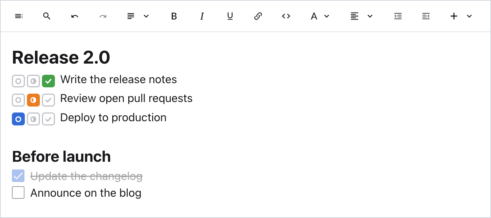

# Super Extended for Standard Notes

The **Super** rich-text editor from [Standard Notes](https://standardnotes.com), packaged as a custom editor plugin, with extra blocks on top. Notes are stored in the same format as built-in Super notes.



Not affiliated with or endorsed by Standard Notes.

## Install

1. In Standard Notes, open **Preferences → Plugins → Install Custom Plugin**.
2. Paste this URL, press **Install**, and confirm:
   ```
   https://sinpai.github.io/sn-super-extended/ext.json
   ```
3. Open a note, then go to note options → **Change note type** → **Super Extended**.

## Features

Everything from Super: the formatting toolbar, the `/` block menu, Markdown shortcuts, headings, bulleted, numbered and check lists, quotes, code blocks with syntax highlighting, tables, collapsible sections, dividers, a password generator, date and time, images from a URL, drag handles, search and replace (Cmd/Ctrl+F), Markdown preview (Cmd/Ctrl+Shift+M), "Prevent editing", and your Standard Notes theme.

### Task Status

Three boxes at the start of a line: **To do** (blue), **In progress** (orange) and **Done** (green). The selected box is filled with its color and the other two are gray. Click a box to change the status.

- Add it by typing `/task`, or from the toolbar's block menu → **Task Status**. It applies to the current line, or to every selected line.
- Press Enter on a task line to start the next task. Press Enter on an empty task line to end the list.
- Backspace right after the boxes turns the line back into normal text.
- Works in paragraphs, headings, quotes, list items and table cells.
- Markdown preview and copy as plain text show the status as `[ ]`, `[/]` or `[x]`.

## Good to know

### Differences from built-in Super

Standard Notes runs plugins in a sandboxed frame that can only see the note being edited. Because of that:

- **Files** you upload, paste or drop are stored inside the note itself rather than as separate encrypted files. Super Extended asks before embedding anything over 2 MB, because large notes are slower to sync.
- **Attached files and links to other notes or tags** made in built-in Super show as placeholders. They are kept and appear normally again in built-in Super.
- **Not available:** `@` linking, "Create new note from selection" and "Save to Files".
- **Font size and line height** use the defaults rather than your Standard Notes preferences.
- **Export** from the note menu saves the raw note data (JSON). To get Markdown, open the Markdown preview (Cmd/Ctrl+Shift+M) and press **Copy**.

### Moving notes between Super and Super Extended

- **From Super to Super Extended:** Standard Notes shows a conversion dialog. **Convert** and **Convert As-Is** both keep the content unchanged.
- **From Super Extended to Super:** choose **Convert As-Is**. The default **Convert** button reads the note as HTML and garbles it.
- **Notes that contain Task Status lines can't be opened in built-in Super**, which doesn't know that block. Keep them in Super Extended; their content isn't changed or lost.
- **Plain text and Markdown notes** are converted the first time you open them in Super Extended. The original text stays until you edit the note.
- If a note contains blocks this version doesn't know (for example, ones added in a newer Super release), Super Extended shows a message instead of opening it, so nothing gets overwritten.

### Privacy

Super Extended is a static web page with no server and no analytics. Standard Notes loads it in a sandboxed frame and gives it the decrypted text of the note you open with it. The plugin never sends note content anywhere except back to Standard Notes when it saves. Like any third-party plugin, it is loaded from its host (here, GitHub Pages) each time. All the code is in this repository; you can review it or [host your own copy](#hosting-your-own-copy).

### Updates

New versions are published automatically when the repository's `main` branch changes. Standard Notes loads the plugin from the same URL every time, so you get updates after the app reloads, without reinstalling.

## Development

Requires Node.js 20.19+ or 22.12+.

```sh
npm install
npm run dev
```

| URL | What it is |
| --- | --- |
| http://localhost:5173/ | Standalone mode. The note is kept in the browser's localStorage. Fastest way to work on the editor. |
| http://localhost:5173/dev/host.html | Test harness that embeds the plugin the way Standard Notes does (same iframe sandbox and message protocol). Buttons simulate "Prevent editing", edits from another device, renaming, switching notes, Markdown notes and a dark theme. |
| http://localhost:5173/ext.json | Manifest for installing the dev server in the Standard Notes desktop app. |

Other scripts: `npm run typecheck`, `npm run build`, and `npm run preview`, which serves `dist/` on port 4173. To test the production build in the harness, open `dev/host.html?plugin=http://localhost:4173/`.

Browsers may refuse to let the hosted Standard Notes web app load a `http://localhost` plugin. Use the desktop app for that, or test a deployed copy.

### Project layout

```
src/
  main.tsx               Entry point: Standard Notes bridge when embedded, standalone mode otherwise
  plugin/                Code that adapts the editor to run as a plugin
    host/RelayHost.ts      Bridge to Standard Notes (@standardnotes/component-relay): load, save, lock state
    PluginNoteController.ts  Plugin version of upstream's NoteViewController
    PluginApplication.ts     The parts of upstream's WebApplication the editor uses
    PluginRoot.tsx           Loads the note, converts non-Super text, renders the editor
    config.ts                Plugin identifier, name and limits
  extensions/            Features added in this project (TaskStatus). Imported as `@extensions/`
  web/javascripts/       Copied from standardnotes/app packages/web/src/javascripts, same paths (`@/`)
  web/stylesheets/       Copied from packages/web/src/stylesheets
  packages/              Copied subsets of other packages in the monorepo (icons, keyboard handling, ...)
  compat/                Small stand-ins for the @standardnotes/* package entry points
dev/                     Test harness (dev/host.html)
docs/                    README assets
upstream/manifest.json   Every copied upstream file, with the hash it was last synced from
scripts/upstream.mjs     Compares and syncs the copied files with a Standard Notes checkout
```

### How it's built

The editor is the upstream Super code from [standardnotes/app](https://github.com/standardnotes/app) (commit `f64d5a4`, web app 3.203.0, Lexical 0.49.0), copied unchanged to the same relative paths.

Upstream files that need the Standard Notes app internals are replaced by plugin versions with the same exports. Each one starts with a comment explaining why:

- `Components/SuperEditor/SuperEditor.tsx`: loads and saves through the plugin bridge
- `Components/SuperEditor/Plugins/EncryptedFilePlugin/FilePlugin.tsx`: uploads become inline embeds
- `…/EncryptedFilePlugin/Nodes/FileComponent.tsx`, `…/ItemBubblePlugin/Nodes/BubbleComponent.tsx`: placeholders
- `Components/ApplicationProvider.tsx`, `Components/KeyboardServiceProvider.tsx`, `Hooks/usePreference.tsx`, `NativeMobileWeb/useAndroidBackHandler.tsx`

Smaller changes inside otherwise unchanged files are marked with `[sn-super-extended]`. To list them, run `grep -rn "\[sn-super-extended\]" src`.

### Adding features

- **A block for the `/` menu or toolbar:** follow `src/extensions/TaskStatus/TaskStatusBlock.tsx`, or the upstream blocks in `Components/SuperEditor/Plugins/Blocks/`. Register it in `BlockPickerPlugin/BlockPickerPlugin.tsx` and/or `ToolbarPlugin/ToolbarPlugin.tsx`.
- **Editor behavior (a Lexical plugin):** mount it inside `<BlocksEditor>` in `SuperEditor.tsx`.
- **A new node type:** register it in `Lexical/Nodes/AllNodes.ts`. Built-in Super can't open notes that contain node types it doesn't know. Once notes use a node, keep its `getType()` value.
- **Settings:** `const [value, setValue] = usePluginSetting('key')`, after adding the key to `PluginSettings` in `src/plugin/PluginPreferences.ts`. Values are stored with the plugin and sync across devices.
- **Access to other notes or tags:** the component relay supports streaming and creating items, with a permission prompt for the user. Start in `src/plugin/host/RelayHost.ts`.

### Hosting your own copy

**On GitHub Pages:** fork the repository, then set **Settings → Pages → Source** to **GitHub Actions**. The workflow in `.github/workflows/deploy.yml` builds and publishes on every push to `main`. Your install URL is `https://<user>.github.io/<repo>/ext.json`.

**Elsewhere:** build with the public URL where the files will be served, then upload `dist/` to any static HTTPS host:

```sh
PLUGIN_URL=https://example.com/super-extended/ npm run build
```

This writes `dist/ext.json`, which is the URL to install. The host must serve `ext.json` with an `Access-Control-Allow-Origin` header. Standard Notes rejects plugin URLs that contain one of its own identifiers (`org.standardnotes.…`).

**Identifier:** every note records the identifier of the editor it uses. If you want your copy installed alongside this one, change `identifier` and `name` in `src/plugin/config.ts` before you use it. Changing the identifier later makes existing notes open in the plain text editor until you switch them back.

### Updating from upstream

```sh
git clone --depth 1 https://github.com/standardnotes/app ../sn-app
npm run upstream:status -- ../sn-app     # what changed upstream, and what changed here
npm run upstream:sync -- ../sn-app       # update the files that weren't changed here
node scripts/upstream.mjs diff ../sn-app packages/web/src/javascripts/Components/SuperEditor/SuperEditor.tsx
node scripts/upstream.mjs add ../sn-app packages/web/src/javascripts/<path>   # copy and track another file
```

`sync` keeps local changes. When a file changed both upstream and here, it writes the upstream version to `upstream/conflicts/` for manual merging. For replaced files it only reports that upstream changed. Afterwards, match the Lexical versions in `package.json` to upstream's `packages/web/package.json`, then run `npm run typecheck && npm run build`.

## Contributing

Issues and pull requests are welcome. Before opening a pull request, make sure `npm run build` passes. For changes to the editor, check them in both standalone mode and `dev/host.html`.

## License

Super Extended is licensed under the [GNU Affero General Public License v3.0](LICENSE) (AGPL-3.0).

It is a modified version of the Super editor from [Standard Notes](https://github.com/standardnotes/app), which is also licensed under AGPL-3.0. The changes are described in [How it's built](#how-its-built) and in the git history. Packages installed from npm, such as [Lexical](https://lexical.dev), keep their own licenses.

You may use, study, change and share this software. If you share a modified version, including hosting it for other people to install as a plugin, you must make its complete source code available to those users under AGPL-3.0, for example by publishing your fork.
